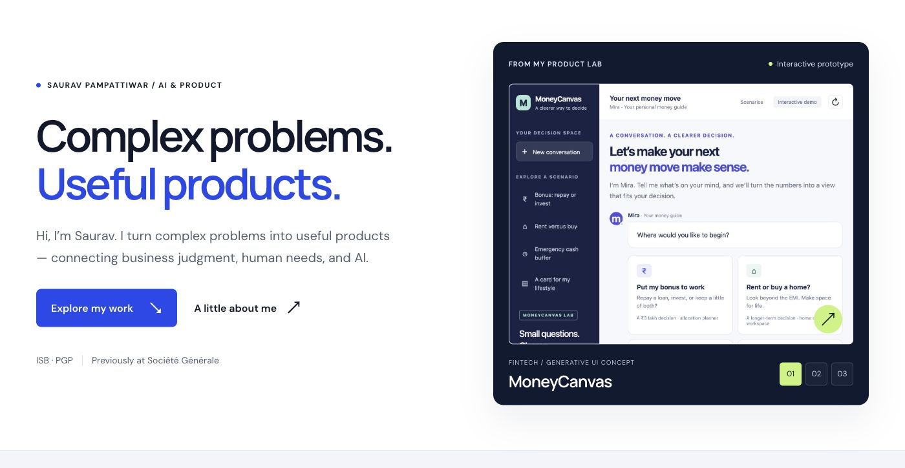

# Saurav Pampattiwar — Product Portfolio

A personal product portfolio with a white, ink, and cobalt design, readable Manrope and DM Sans typography, interactive product spotlight, five project stories, and professional experience.

**Live:** https://product-portfolio-brown-one.vercel.app



## Launch on Vercel

1. Open [Vercel’s new project page](https://vercel.com/new).
2. Import **githubsaurav/product-portfolio** and select the **main** branch.
3. Keep the root directory at the repository root (`./`).
4. Deploy. The checked-in `vercel.json` selects **Other**, runs `npm run build`, and publishes `dist/`.

No environment variables, API keys, paid services, or runtime dependencies are required. Future pushes to the connected production branch can deploy automatically through Vercel’s Git integration. See [Vercel build configuration](https://vercel.com/docs/builds/configure-a-build).

## Preview locally

Requires Node.js 20 or newer.

```sh
npm run dev
```

Open http://127.0.0.1:4185. Use `PORT=4186 npm run dev` if that port is occupied. After editing source files, run `npm run build` and refresh the browser; there is no hot-reload dependency.

```sh
npm run build
npm run check
```

The check verifies JavaScript syntax and built HTML links, image paths, headings, metadata, and external-link safety. The final site is plain HTML, CSS, and a small amount of JavaScript. All project stories and the full gallery are available even if JavaScript is disabled.

## Update the content

- `site/index.html`: introduction, experience, approach, biography, and contact section.
- `scripts/projects.mjs`: all five projects, case-study copy, tags, screenshots, and destination links.
- `site/styles.css`: typography, colors, layout, and responsive breakpoints.
- `site/app.js`: gallery filters, mobile navigation, email copy, and footer year.
- `site/assets/`: actual project screenshots, favicon, social preview, and licensed local fonts.
- `scripts/build.mjs`: generates the homepage, five project pages, and custom 404.

Edit source files, then build. Do not edit `dist/`, which is generated and excluded from Git.

After the first deployment, you may add the production domain as the repository’s About website. This repository intentionally does not claim a Vercel URL before one exists.

## Content and attribution

The featured projects are independent concepts or research artifacts. Their pages distinguish simulated product experiences from production work and describe proposed next tests as future work. Career outcomes are based on the owner’s supplied resume; no employer materials, private repositories, raw resumes, or proprietary source code are included.

Screenshot source: the owner’s public Vercel projects, reviewed 17 October 2026. The project named `learning-product-management` currently hosts a merchant research atlas, which is reflected in the portfolio.

Design references reviewed: [product portfolio examples](https://www.sitebuilderreport.com/inspiration/product-manager-portfolios), [Linus Lee](https://thesephist.com/), and [Lauren M Khoo](https://laurenmkhoo.com/). The layout, product spotlight, typography treatment, and code here are original; reference-site assets were not copied.

DM Sans and Manrope are distributed under the SIL Open Font License; licenses are included alongside their font files. Prototype brand references do not imply affiliation or endorsement. No analytics, forms backend, or live AI integration is included.
